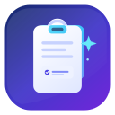

# CopyLoad

<div align="center">
  
  <h3>Clipboard history for Chrome &amp; Edge</h3>
  <p>Save text and images you copy, search them later, paste from history, and lock the UI with a PIN — all on your device.</p>

  [](https://github.com/anhhackta/CopyLoad-Extension/releases/latest)
  [](LICENSE)
  [](manifest.json)
</div>

<p align="center">
  <b>English</b>
  · <a href="README_VN.md">Tiếng Việt</a>
  · <a href="README_ZH.md">中文</a>
  · <a href="README_JP.md">日本語</a>
  · <a href="https://anhhackta.github.io/CopyLoad-Extension/">Website</a>
  · <a href="https://github.com/anhhackta/CopyLoad-Extension/releases">Releases</a>
</p>

---

## Why CopyLoad?

Browsers forget what you copied. CopyLoad keeps a **local** history of text and images so you can find, pin, and paste snippets without sending clipboard data to any server.

**Current line:** `v1.0.2` on branch `main` (long-term updates).  
**First public build:** [`Ver1.1.1`](https://github.com/anhhackta/CopyLoad-Extension/releases/tag/Ver1.1.1) on branch `legacy-old` (text-only, older architecture).

---

## Features

| Area | What you get |
|------|----------------|
| **Capture** | Auto-save on Ctrl+C / cut / paste (toggleable); right-click → *Save to CopyLoad* / *Save image to CopyLoad* |
| **Text** | Search, classify (text / link / email / number / code), pin, bulk select, temp vs permanent storage |
| **Images** | Context-menu save or paste from system clipboard; thumbnails; pin / delete |
| **Paste Multi** | Ctrl+V in an input opens history picker (suggestion box or quick keys `1`–`0`); use Ctrl+Shift+V for a normal paste |
| **Security** | Optional 4–6 digit PIN for popup, manager, and Paste Multi; auto-lock timeout |
| **Data** | Export / import JSON (optional password encryption), plain `.txt` export, auto-delete old items, clear all |
| **UI** | Light / dark / system theme; Vietnamese & English in-app; compact popup + full manager page |
| **Storage** | IndexedDB for history; `chrome.storage` for settings; no analytics, no network calls for clipboard |

---

## Install (ZIP / Load unpacked)

1. Download **Latest** from [Releases](https://github.com/anhhackta/CopyLoad-Extension/releases/latest) (`CopyLoad-1.0.2.zip`).
2. Unzip the folder (keep the structure; do not nest extra parent folders incorrectly).
3. Open `chrome://extensions` or `edge://extensions`.
4. Enable **Developer mode**.
5. Click **Load unpacked** and select the folder that contains `manifest.json`.

> Not published on the Chrome Web Store or Edge Add-ons yet.

---

## Quick start

| Task | How |
|------|-----|
| Save text | Ctrl+C (if enabled in Settings) or right-click → Save to CopyLoad |
| Save image | Right-click image → Save image…, or Images tab → Paste image |
| Paste from history | Enable Paste Multi → focus an input → Ctrl+V → pick an item |
| Normal paste | Ctrl+Shift+V or the page’s context-menu Paste |
| Open manager | External-link button in the popup header |
| Lock | Settings → enable PIN |

---

## Project layout

```
CopyLoad/
├── manifest.json
├── icons/
├── src/
│   ├── background/   # service worker (menus, DB writes, cleanup)
│   ├── content/      # copy/paste listeners + Paste Multi picker
│   ├── app/          # popup + manager UI
│   └── shared/       # constants, i18n, db, settings, lock, crypto
├── index.html        # product landing (GitHub Pages)
├── README.md         # English (this file)
├── README_VN.md      # Vietnamese
├── README_ZH.md      # Chinese
├── README_JP.md      # Japanese
└── LICENSE           # MIT
```

---

## Privacy

- Clipboard content stays on the device (IndexedDB / `chrome.storage`).
- No telemetry, ads, or remote clipboard sync.
- PIN is a UI lock (PBKDF2 hash in local storage). IndexedDB is not fully encrypted at rest; JSON exports can use AES-GCM when you set a password.

---

## License

[MIT](LICENSE) — free to use, modify, and redistribute **with attribution** (keep the copyright notice).

---

## Author

**Nguyễn Bá Hoàng** ([@anhhackta](https://github.com/anhhackta))

- Site: [anhhackta.com](https://anhhackta.com) · [GitHub Pages](https://anhhackta.github.io/CopyLoad-Extension/)
- Facebook: [anhhackta.official](https://facebook.com/anhhackta.official)
- Support: [Buy Me a Coffee](https://www.buymeacoffee.com/anhhackta)
